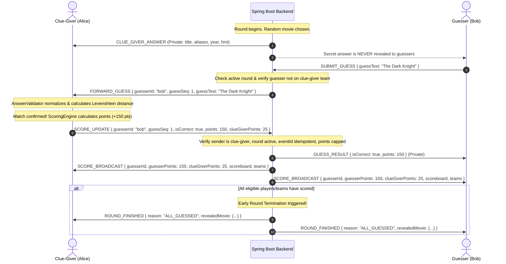

# MovieClash — System Architecture & Design Document

MovieClash is a low-latency, real-time multiplayer movie guessing game engineered with a **modular monolith** backend and a **vanilla JavaScript** frontend.

---

## 1. Core Architectural Tenets

1. **Minimal Backend Workload:**
   - The backend coordinates room presence, turns, and scores.
   - The clue-giver's browser serves as the **answer validation authority**.
   - Zero database round-trips. Zero audio traffic on Spring Boot. Zero per-second tick loops.
2. **Predictable Latency & Concurrency:**
   - Mutations inside a room are serialized using per-room `ReentrantLock` wrappers (`room.executeLocked(...)`).
   - Non-blocking WebSocket message handling. Scheduled timers for round deadlines.
3. **Casual-Game Trust Model:**
   - Guess validation, string normalization, and edit-distance matching occur entirely in the clue-giver's browser.
   - The server validates permissions (is sender the clue-giver? is round active? points within configured max?), but does NOT recalculate scoring formulas.

---

## 2. Component Diagram

```
┌─────────────────────────────────────────────────────────────────────────────┐
│                           Frontend Architecture                             │
│                                                                             │
│  ┌──────────────┐     ┌──────────────┐     ┌──────────────┐     ┌────────┐  │
│  │  State Store │◄────┤ View Routers ├────►│  Audio Voice │     │ Engine │  │
│  │  (Reactive)  │     │ (DOM Views)  │     │(LiveKit SFU) │     │(Val/Sc)│  │
│  └──────┬───────┘     └──────────────┘     └──────────────┘     └───┬────┘  │
│         │                                                           │       │
│         ▼                                                           │       │
│  ┌──────────────┐                                                   │       │
│  │  WebSocket   │◄──────────────────────────────────────────────────┘       │
│  │    Client    │                                                           │
│  └──────┬───────┘                                                           │
└─────────┼───────────────────────────────────────────────────────────────────┘
          │ JSON Envelopes over WSS (ws/game)
          ▼
┌─────────────────────────────────────────────────────────────────────────────┐
│                      Backend Architecture (Spring Boot)                      │
│                                                                             │
│  ┌────────────────────────┐         ┌────────────────────────────────────┐  │
│  │   WebSocket Gateway    │────────►│          GameCoordinator           │  │
│  │ (TextWebSocketHandler) │         │       (Central Event Router)       │  │
│  └────────────────────────┘         └──────────────┬─────────────────────┘  │
│                                                    │                        │
│           ┌────────────────────────────────────────┼────────────────────┐   │
│           ▼                                        ▼                    ▼   │
│  ┌─────────────────┐                     ┌──────────────────┐  ┌──────────┐ │
│  │   RoomManager   │                     │   RoundManager   │  │ScoreSync │ │
│  │ (In-Memory Map) │                     │ (Turn Timers/Cat)│  │(Authority│ │
│  └─────────────────┘                     └──────────────────┘  │ Verifier)│ │
│           ▲                                        ▲           └──────────┘ │
│           │                                        │                        │
│  ┌────────┴────────┐                     ┌─────────┴────────┐               │
│  │ ReconnectionMgr │                     │ CancellationMgr  │               │
│  │ (Grace/Snapshot)│                     │ (Majority Vote)  │               │
│  └─────────────────┘                     └──────────────────┘               │
└─────────────────────────────────────────────────────────────────────────────┘
```

---

## 3. Sequence Diagrams

### 3.1 Answer Validation Authority Flow



---

### 3.2 Team Battle Turn & Opposing Scoring Flow

```mermaid
sequenceDiagram
    autonumber
    participant Server as Backend
    actor TeamA1 as Team Alpha (Alice - Clue-Giver)
    actor TeamA2 as Team Alpha (Charlie - Teammate)
    actor TeamB1 as Team Beta (Bob - Opponent)

    Note over Server: Round 1: Team Alpha Turn (Alice giving clues)
    Server->>TeamA1: CLUE_GIVER_ANSWER ("Inception")
    
    TeamA2->>Server: SUBMIT_GUESS ("Inception")
    Server-->>TeamA2: ERROR: UNAUTHORIZED ("Teammates of clue-giver cannot guess")

    TeamB1->>Server: SUBMIT_GUESS ("Inception")
    Server->>TeamA1: FORWARD_GUESS { guesser: "Bob", team: "TEAM_B" }
    TeamA1->>Server: SCORE_UPDATE { points: 150, clueGiverPoints: 25 }

    Note over Server: Team Beta gets +150; Team Alpha gets +25!
    Server->>TeamB1: SCORE_BROADCAST { Team Beta: 150, Team Alpha: 25 }
    Server->>TeamA2: SCORE_BROADCAST { Team Beta: 150, Team Alpha: 25 }

    Note over Server: Round 2 advances -> Team Beta's turn (Round-robin)
```

---

### 3.3 Mid-Round Clue-Giver Reconnection & Answer Recovery

```mermaid
sequenceDiagram
    autonumber
    actor ClueGiver as Clue-Giver (Alice)
    participant Server as Backend
    actor Guesser as Guesser (Bob)

    Note over ClueGiver: Socket abruptly closes / page reloads
    Server->>Guesser: PLAYER_DISCONNECTED { playerId: "alice", gracePeriodMs: 60000 }
    Note over Server: Start 15s turn pause/skip timer

    Note over ClueGiver: Browser tab reopens; loads session from sessionStorage
    ClueGiver->>Server: RECONNECT { roomId: "XYZ", playerId: "alice", reconnectToken: "..." }

    Note over Server: Token validated & grace period verified
    Server->>ClueGiver: PLAYER_RECONNECTED { room, scoreboard, deadline, recentChat }
    Note over Server: Cancel turn-skip timer! Resend secret movie privately:
    Server->>ClueGiver: CLUE_GIVER_ANSWER { title: "Interstellar", aliases: [...] }
    Server->>Guesser: PLAYER_RECONNECTED { player: "Alice" }
```

---

## 4. Concurrency & State Mutation Isolation

1. **Per-Room Lock Granularity:**
   Every room possesses an independent `java.util.concurrent.locks.ReentrantLock`.
   All player joins, leaves, guesses, scoring events, and round transitions run inside:
   ```java
   room.executeLocked(() -> {
       // Mutation isolated to this room
   });
   ```
2. **WebSocket Thread Safety:**
   Spring's `WebSocketSession.sendMessage` is non-thread-safe. In `RoomBroadcaster`, every outgoing frame synchronizes on the target `WebSocketSession` instance with socket state checks (`session.isOpen()`), catching `IllegalStateException` gracefully.
3. **Zero DB Latency:**
   Zero database connections exist. All lookup operations are $O(1)$ in JVM `ConcurrentHashMap`.

---

## 5. Network & CPU Optimization Matrix

| Mechanism | Optimization | Benefit |
|---|---|---|
| **Deadline Timestamps** | Send `deadline` and `serverTime` once in `ROUND_STARTED` | Zero continuous per-second countdown network packets |
| **Delta Broadcasting** | Send only modified attributes (`ROOM_UPDATED`) | 85% bandwidth reduction compared to full snapshots |
| **Audio SFU Offload** | WebRTC mesh handled directly by LiveKit Cloud | Zero voice CPU / zero audio network footprint on Spring Boot |
| **Rolling Chat Buffer** | Keep last 50 chat messages per room in memory | Instant context recovery on reconnect without unbounded RAM growth |
| **Idempotent Scoring** | Deduplicate scoring via unique `eventId` and `roundCorrectGuessers` | Eliminates race conditions and double-scoring bugs |

